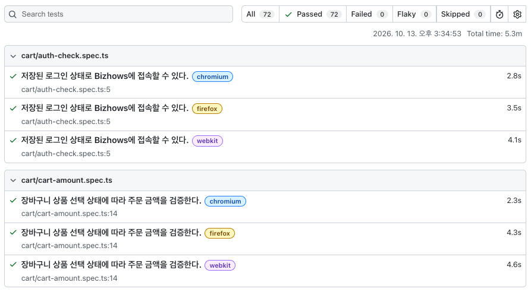
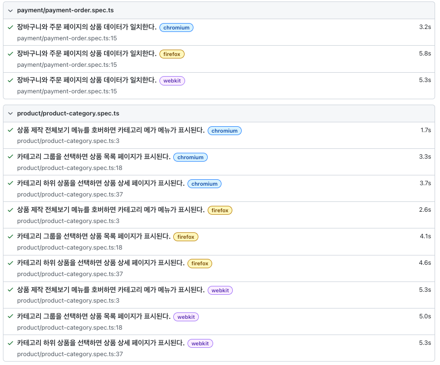
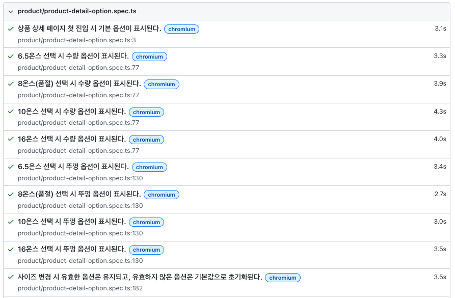
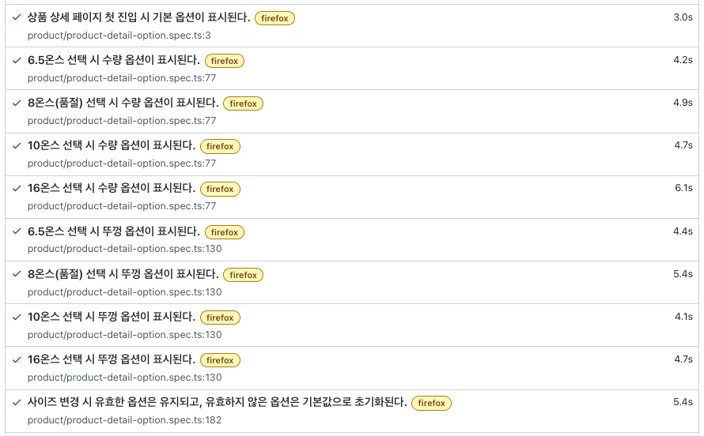
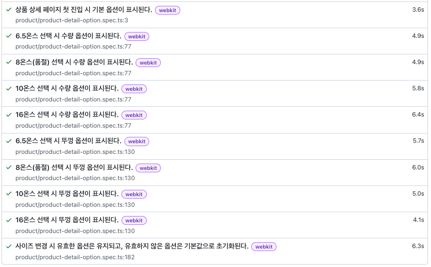
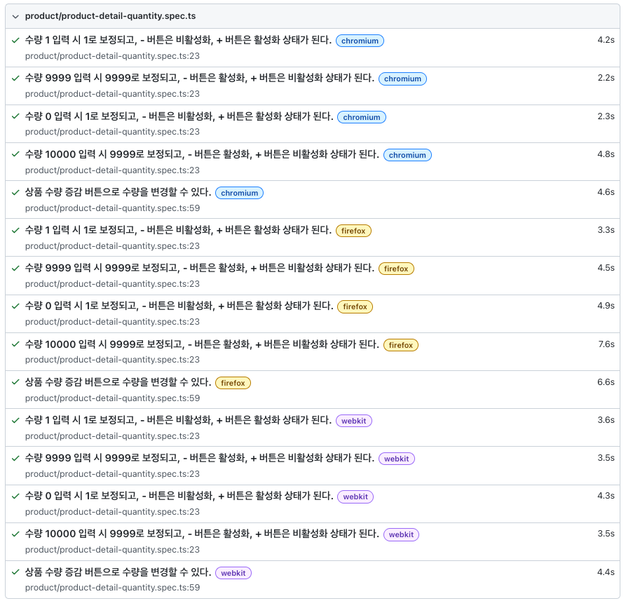
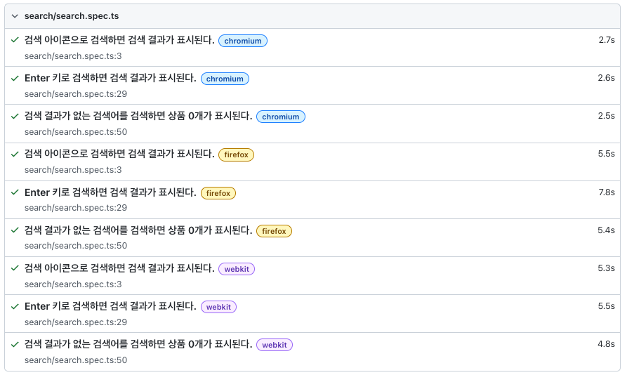

# Bizhows QA Portfolio

Bizhows 웹 서비스의 핵심 구매 여정을 대상으로 테스트를 설계하고, 반복 실행과 회귀 검증에 적합한 시나리오를 Playwright로 자동화한 QA 포트폴리오 프로젝트입니다.

## 프로젝트 개요

| 항목        | 내용                          |
| ----------- | ----------------------------- |
| 테스트 대상 | Bizhows 웹 서비스             |
| 테스트 기간 | 2026.09.21 ~ 2026.10.13       |
| 테스트 환경 | Production                    |
| 실행 환경   | macOS · Desktop · Chrome 중심 |
| 주요 기술   | Playwright · TypeScript       |

## 테스트 목표

- 상품 탐색부터 결제 직전까지의 핵심 User Journey 품질 확인
- 리스크 기반 테스트 설계 및 우선순위 선정
- 반복 수행과 회귀 검증에 적합한 자동화 영역 식별
- 상품 옵션, 수량, 장바구니 금액, 주문 페이지 데이터의 일관성 검증

## 테스트 범위

### In Scope

- 상품 검색
- 카테고리와 상품 목록 탐색
- 상품 상세 옵션 선택
- 상품 수량 입력 및 증감
- 장바구니 상품 선택과 주문 금액
- 주문 정보, 주문자 번호, 배송지 정보
- 결제 직전 주문 정보

### Out of Scope

- 회원가입 및 로그인 기능 자체
- 실제 주문 및 결제
- 쿠폰·프로모션
- 환불·교환·배송
- 마이페이지
- 디자인 편집기
- 관리자 기능
- 서버/API 내부 검증
- 성능·보안 전문 테스트

## 테스트 전략

핵심 User Journey를 기준으로 수동 테스트와 자동화 테스트를 병행했습니다.

- **Manual 약 70%**: 탐색적 테스트, UI/UX, 예외 상황, 복잡한 조건 검증
- **Automation 약 30%**: 반복 실행 가능하고 결과가 명확한 핵심 회귀 시나리오
- **리스크 기반 우선순위**: 영향도와 가능성을 기준으로 High·Medium·Low 분류
- **테스트 설계 기법**: 동등분할, 경계값 분석, 결정 테이블, 상태 전이

테스트 계획서 기준으로 총 90개의 테스트 케이스를 관리했으며, 그중 반복 회귀와 자동화 효율이 높은 핵심 시나리오를 Playwright로 구현했습니다.

## 자동화 테스트 범위

| 영역        | 자동화 내용                                       | 코드                                            |
| ----------- | ------------------------------------------------- | ----------------------------------------------- |
| 검색        | 정상 검색, 검색 결과 없음, 검색 아이콘·Enter 실행 | `tests/search/search.spec.ts`                   |
| 카테고리    | 메가메뉴 노출, 카테고리 목록, 상품 상세 이동      | `tests/product/product-category.spec.ts`        |
| 상품 옵션   | 기본 옵션, 사이즈·뚜껑 옵션, 품절 및 옵션 변경    | `tests/product/product-detail-option.spec.ts`   |
| 상품 수량   | 수량 입력, 최소·최대 경계값, 증감 버튼 상태       | `tests/product/product-detail-quantity.spec.ts` |
| 장바구니    | 상품 0개·1개·2개 선택에 따른 주문 금액            | `tests/cart/cart-amount.spec.ts`                |
| 주문 페이지 | 장바구니와 주문 페이지의 상품·옵션·수량·가격 비교 | `tests/payment/payment-order.spec.ts`           |

## 주요 검증 포인트

- 동적 렌더링이 완료된 후 상품 옵션과 수량 Locator를 검증
- 상품 옵션 조합에 따른 선택 상태와 품절 상태 확인
- 최소·최대 수량에서 입력값과 증감 버튼 상태 확인
- 장바구니 상품 선택 상태에 따른 주문 금액·할인 금액·배송비·총 금액 계산 검증
- 장바구니와 주문 페이지 사이의 상품 데이터 일치성 검증
- 로그인 UI를 반복 실행하지 않고 `storageState`로 인증 상태 재사용

## 시작하기

### 설치

```bash
npm install
npx playwright install
```

### 로그인 상태 설정

장바구니와 주문 페이지 테스트는 저장된 로그인 상태를 사용합니다. 최초 실행 전 아래 명령으로 브라우저를 열고 수동 로그인합니다.

```bash
npx playwright codegen \
  --save-storage=playwright/.auth/user.json \
  https://www.bizhows.com/ko
```

로그인한 뒤 장바구니에 상품 2개를 수동으로 추가하고 브라우저를 종료합니다. 생성된 `playwright/.auth/user.json`은 세션 정보가 포함될 수 있으며 `.gitignore`에 의해 Git에서 제외됩니다.

저장된 인증 상태는 다음 테스트로 확인할 수 있습니다.

```bash
npx playwright test tests/auth/auth-check.spec.ts
```

### 테스트 실행

전체 테스트 실행:

```bash
npx playwright test
```

특정 테스트 실행:

```bash
npx playwright test tests/cart/cart-amount.spec.ts
```

Chromium에서만 실행:

```bash
npx playwright test tests/cart/cart-amount.spec.ts --project=chromium
```

HTML 리포트 확인:

```bash
npx playwright show-report
```

## 프로젝트 구조

```text
.
├── helpers/
│   ├── cart.ts       # 장바구니 Locator·동작·금액 조회 헬퍼
│   ├── options.ts    # 상품 옵션 데이터 처리
│   └── price.ts      # 가격 문자열 파싱
├── tests/
│   ├── cart/         # 로그인 상태·장바구니 금액 테스트
│   ├── payment/      # 주문 페이지 데이터 비교 테스트
│   ├── product/      # 카테고리·상품 옵션·수량 테스트
│   └── search/       # 검색 테스트
├── docs/
│   └── troubleshooting/ # 문제 분석과 해결 과정
├── playwright.config.ts
└── package.json
```

## 트러블슈팅 문서

자동화 과정에서 발생한 문제와 해결 방법은 기능별로 정리했습니다.

- [대표 트러블슈팅](docs/troubleshooting/README.md)
- [장바구니 테스트 가이드](tests/cart/README.md)
- [장바구니 트러블슈팅](docs/troubleshooting/cart/README.md)
- [결제 트러블슈팅](docs/troubleshooting/payment/README.md)
- [상품 트러블슈팅](docs/troubleshooting/product/README.md)
- [카테고리 트러블슈팅](docs/troubleshooting/category/README.md)
- [검색 트러블슈팅](docs/troubleshooting/search/README.md)
- [테스트 실행 트러블슈팅](docs/troubleshooting/test-execution/README.md)

## 제약사항

- 운영 서비스에서 테스트하므로 실제 주문과 결제는 수행하지 않습니다.
- 장바구니와 주문 페이지 테스트는 로그인 세션과 운영 데이터에 의존합니다.
- 장바구니 금액 테스트는 실행 전에 상품 2개를 수동으로 준비해야 합니다.
- 공개된 UI와 실제 동작을 기준으로 기대 결과를 정의했으며, 확인할 수 없는 내부 정책은 테스트 범위에서 제외했습니다.

## 실행 결과








